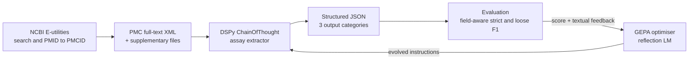

# AI-Enabled Pathogen Tracking: LLM Extraction of Assay Data from Biomedical Literature

An automated pipeline that reads full-text research articles from PubMed Central and extracts structured, per-isolate pathogen surveillance data (serotype, MLST, antimicrobial susceptibility, resistance genes, plasmids, virulence factors and more). It uses [DSPy](https://dspy.ai) for declarative prompt programming and [GEPA](https://gepa-ai.github.io/gepa/) (Genetic-Pareto) for automatic prompt optimisation, evaluated across three Claude models.

This repository holds the code for my MSc Artificial Intelligence capstone (Design/Implementation project, AI6129) at the College of Computing and Data Science, Nanyang Technological University, Singapore. The work ran from August 2025 to April 2026 in collaboration with a food safety partner organisation.

## Headline results

| Finding | Evidence |
|---------|----------|
| GEPA improves extraction, on the right model | Claude Sonnet 4.5 strict micro F1 rose from **0.520 to 0.648** (+12.8 pp, **+24.6% relative**) on a 35-article holdout set |
| Optimised prompts transfer upward | The Sonnet 4.5 optimised prompt, run unchanged on Sonnet 4.6, scored **0.676**, higher than Sonnet 4.6's own GEPA result |
| More optimisation is not always better | Sonnet 4.5 at 10 evaluation cycles regressed to 0.587. Recall held steady (0.641 to 0.640) and precision collapsed (0.655 to 0.542) |
| Optimisation responsiveness is model-specific | GEPA helped Sonnet 4.5, barely moved Haiku 4.5 (within noise), and longer runs degraded Sonnet 4.6 |
| Ground truth quality dominates everything else | Diagnosing and correcting annotation errors moved mean F1 on the evaluation set from **0.047 to 0.547**, a larger gain than any model or prompt change |

## What the pipeline does



1. **Acquisition.** Searches PubMed by pathogen and date range, converts PMIDs to PMCIDs, and downloads full-text XML through the NCBI E-utilities API, with optional supplementary file download. XML was chosen over PDF because table structure survives intact.
2. **Extraction.** A DSPy `ChainOfThought` module reads the article and returns JSON in one of three categories: isolates with linked assay data, isolates without linked data, or assay information with no isolate identifiers. One unified signature covers bacterial assays (serotype, MLST, cgMLST, AST, AMR, plasmid, PFGE, SPI, toxin, phage type) and viral assays (genotype, subgenotype, viral load, sequencing region, clade, serology).
3. **Evaluation.** Field-specific normalisers (serotype prefixes, AST drug and interpretation pairs, AMR gene names, Unicode dashes) feed a per-category scorer. Strict F1 is the primary metric. A token-containment "loose" F1 is reported alongside to separate wrong answers from correct but verbose ones.
4. **Optimisation.** GEPA evolves the extraction instructions using a rule-based feedback metric. The metric returns a score plus diagnostic text (for example, "isolate codes X, Y appear in article tables but were not extracted") that the reflection model uses to propose better prompts.

## Research questions

1. Can an LLM pipeline with DSPy and GEPA improve on an existing BERT-based extraction tool?
2. How much ground truth does GEPA need to be effective?
3. Which candidate model performs best for this task?
4. Do optimised prompts transfer across models and pathogens?

## Experimental setup

| Item | Detail |
|------|--------|
| Corpus | PMC articles on *Salmonella* and *E. coli*, with Hepatitis A and E articles for cross-pathogen tests |
| Evaluable records | 149 after ground truth diagnosis and remediation |
| Splits | Fixed holdout, small stratified validation set (GEPA tracks Pareto scores on it), and 100% / 30% training pools |
| Student models | Claude Haiku 4.5, Sonnet 4.5, Sonnet 4.6 |
| Reflection model | Claude Opus 4.6 |
| GEPA budget | `max_full_evals=5` for the main runs, 10 for an extended Sonnet 4.5 run, `seed=42` |
| Statistics | Wilcoxon signed-rank with rank-biserial effect size, bootstrap 95% CI, McNemar's exact test for category accuracy, Holm-Bonferroni correction |

### Holdout results (strict micro F1)

| Model | Unoptimised baseline | Best GEPA run | Change |
|-------|---------------------|---------------|--------|
| Haiku 4.5 | 0.583 | 0.593 (30% train, 5 evals) | +0.010 |
| Sonnet 4.5 | 0.520 | **0.648** (100% train, 5 evals) | **+0.128** |
| Sonnet 4.6 | 0.571 | 0.644 (30% train, smoke run) | +0.073 |

The best Sonnet 4.5 configuration also reached 94.3% article category classification accuracy, with balanced precision (0.655) and recall (0.641).

## Lessons from the work

- **Check the ground truth before tuning the model.** The first evaluation of the manually labelled test set scored F1 0.047. Almost all of that gap came from annotation and conversion issues, not extraction failures. Run a diagnostic pass on the labels before any optimisation experiment.
- **Validate the evaluator against known-good data.** A single type-check bug once caused most records to score as empty. The evaluator is code and needs tests like any other code.
- **Treat optimisation budget as a hyperparameter.** GEPA showed a clear optimal stopping point. Past it, the evolved prompts encouraged over-extraction.
- **Re-optimise when you change models.** Model capability does not predict how a model responds to an optimised prompt.
- **Some data is out of reach of article text.** Per-isolate tables often live in supplementary Excel or PDF files, and dense figures such as PFGE dendrograms are not reliably readable by vision models. These need separate handling.

## Repository structure

```
src/
  config.py                 Paths, API keys (from .env), model strings, pricing
  run_baseline.py           Unoptimised extraction + evaluation over a PMCID list
  requirements.txt
  extract/
    pubmed_extract_v3_2.py  NCBI E-utilities downloader (interactive, batch, scheduled modes)
    article_loader.py       XML text extraction and ground truth loading
    signatures.py           DSPy signatures (article-only and article + supplementary)
    extractor.py            DSPy extraction modules and JSON parsing
    supp_loader.py          Supplementary file discovery via the attachments library
    run_supp_baseline.py    Extraction run that includes supplementary content
  evaluate/
    normalise.py            Field-specific value normalisation
    scorer.py               Per-category strict and loose scoring
    metric.py               GEPA-compatible metric wrapper
    report.py               CSV, JSON and console reports
  optimise/
    run_gepa.py             GEPA optimisation runner
    feedback_metric.py      Score + textual feedback for the reflection model
    data_loader.py          Builds DSPy examples from the splits file
    run_holdout.py          Holdout inference with an optimised programme
    assay_gepa_splits_v4.json
  utils/                    Ground truth conversion, cleanup and housekeeping scripts
notebooks/                  Earlier Colab experiments (accession extraction, GEPA pilot)
accession_formats.md        NCBI/INSDC accession number format reference
Project_Summary_AI6129_PathogenTracking.md   Design decision log
```

## Running the code

The article corpus and ground truth files are not included in this repository. The scripts expect them under a base directory set by the `PUBMED_BASE_DIR` environment variable.

```bash
cd src
pip install -r requirements.txt
```

Create a `.env` file in `src/`:

```
PUBMED_BASE_DIR=/path/to/data
ANTHROPIC_API_KEY=...
NCBI_API_KEY=...        # optional; raises the E-utilities rate limit
NCBI_EMAIL=you@example.com
```

Typical commands:

```bash
# Download articles for a pathogen and month
python extract/pubmed_extract_v3_2.py interactive --pathogen hepatitis_a --month June --year 2025

# Unoptimised baseline (use --dry-run first to check inputs without LLM calls)
python run_baseline.py --pmcid-list pmcids.txt --model claude-haiku-4.5

# GEPA optimisation (smoke test, then a productive run)
python optimise/run_gepa.py --split-pct 100 --smoke-test
python optimise/run_gepa.py --split-pct 100 --max-full-evals 5 \
    --student-model claude-sonnet-4-6 --reflection-model claude-opus-4-6

# Evaluate an optimised programme on the holdout set
python optimise/run_holdout.py --programme path/to/optimised_programme.json --model claude-sonnet-4-6
```

Model keys live in `config.DSPY_MODEL_STRINGS`. Add an entry there to use another model through LiteLLM (for example Sonnet 4.5 or a Bedrock model).

## Limitations

- The holdout set is small (35 records), so differences under about 0.08 F1 sit within sampling noise.
- Only one pure "isolates without linking" record exists in the corpus, so that category is assessed qualitatively.
- Population-level studies (for example "84% resistant to ampicillin" across 87 isolates) do not fit the per-isolate ground truth schema.
- Articles with very many isolates can exceed the model's output token limit and truncate the JSON.

## Future work

- Batched or sectioned extraction for high-isolate articles
- A population-level extension to the ground truth schema
- Dedicated supplementary and figure extraction pathways
- Viral pathogen ground truth for a proper cross-pathogen evaluation
- Agentic or recursive pipelines once the single-module baseline is saturated

## References

- Khattab, O. et al. (2024). *DSPy: Compiling Declarative Language Model Calls into Self-Improving Pipelines.* ICLR. [arXiv:2310.03714](https://arxiv.org/abs/2310.03714)
- Agrawal, L. A. et al. (2025). *GEPA: Reflective Prompt Evolution Can Outperform Reinforcement Learning.* [arXiv:2507.19457](https://arxiv.org/abs/2507.19457)
- NCBI. *Entrez Programming Utilities Help.* [NBK25501](https://www.ncbi.nlm.nih.gov/books/NBK25501/)

## Acknowledgements

Supervised by Assoc. Prof. Hui Siu Cheng, College of Computing and Data Science, Nanyang Technological University.

## Author

Luqman. [LinkedIn](https://www.linkedin.com/in/luqman-mohdali)
